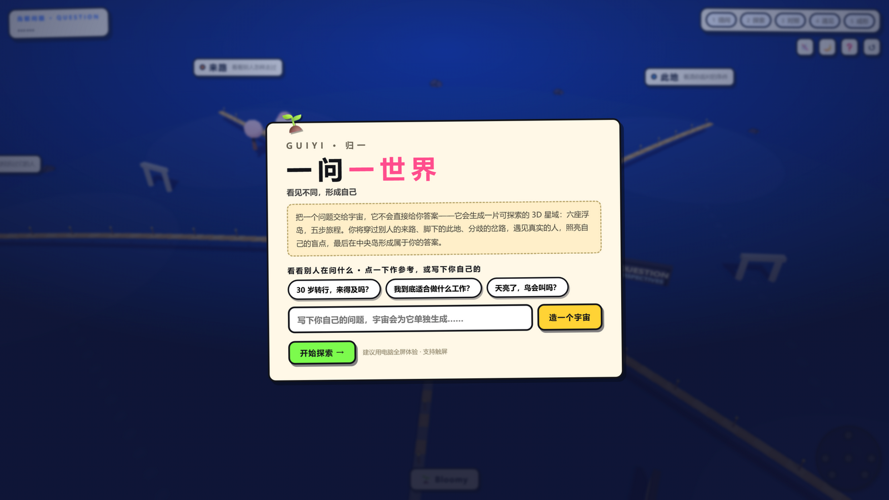
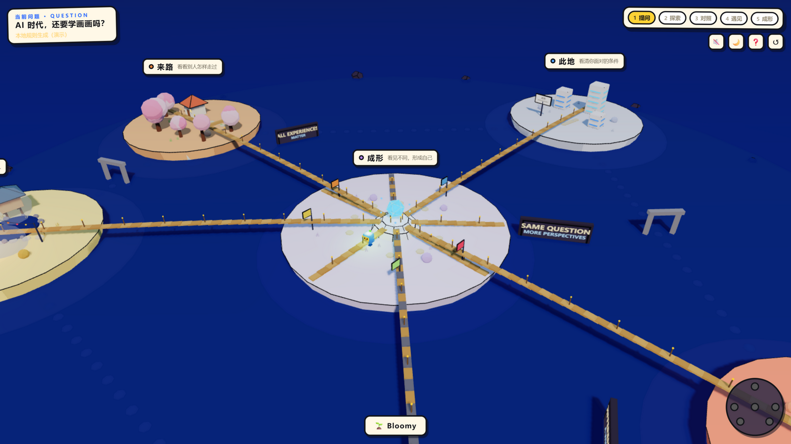
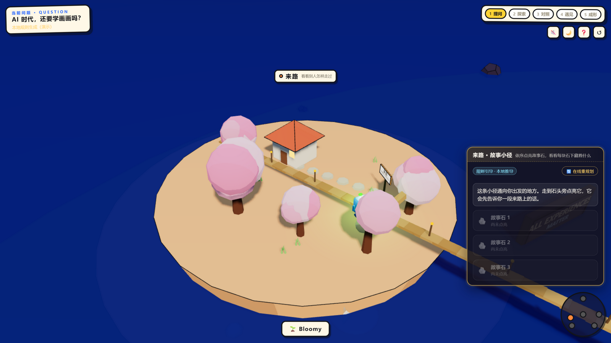
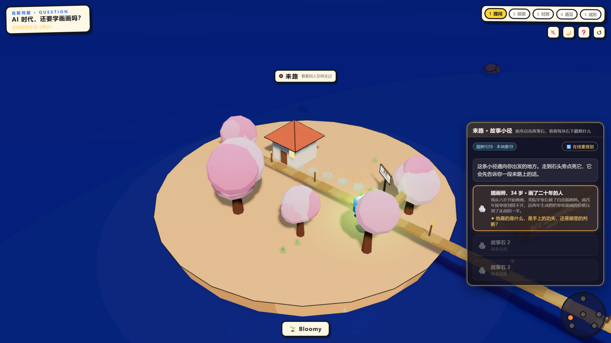

# 归一 · Guiyi Universe — One Question, One World

### Don't hand learners an answer. Hand them a universe they can walk through. / 不直接给答案，而是生成一个可以走进去的宇宙。

**Completed Demo · 已完成小样演示** — a working demo for exploring knowledge in 3D. Ask a question, watch six floating islands rise from the sea and explore them with a little robot called Bloomy. Finish with an answer that is *your own*, rather than the search engine’s.

一个可以运行的三维知识探索小样：提出一个问题，看六座浮岛从海面升起，和一个叫 **Bloomy** 的小机器人一起走完全程，最后得到一个属于你自己的答案——而不是搜索引擎的。

**看见不同，形成自己。 See different perspectives; form your own understanding.**

[How a visit unfolds / 五步旅程](#how-a-visit-unfolds--一次探索的五步) · [Six islands / 六座浮岛](#the-six-islands--六座浮岛) · [Bloomy / 陪伴](#bloomy--全程陪伴的-agent) · [Screenshots / 项目截图](#screenshots--项目截图) · [Technology / 技术](#technology--技术) · [Run / 运行](#run--运行) · [Honest status / 如实说明](#honest-status--如实说明)

## Why build this? / 为什么做

When AI can answer almost any question, *finding* an answer is no longer the difficult bit. What matters is asking the questions a search box never asks:

在 AI 几乎能回答一切问题的时代，稀缺的不再是「找到答案」，而是搜索框从来不问的问题：

- Who has been through this themselves? / 谁真实经历过它？
- Who sees things differently from me, and in what circumstances does each view hold up? / 谁和我想得不一样——各自的观点在什么条件下成立？
- What have I not seen yet? / 还有什么是我没看到的？

Guiyi is deliberately **not** a faster question-and-answer machine. Give it a question and it generates a 3D world you can explore, with different kinds of material in each region. The reward is *encountering different perspectives and gradually forming your own understanding*, rather than collecting points.

所以归一刻意**不做**更快的问答机器。你交给它一个问题，它为你生成一个可以走进去的三维认知宇宙：不同区域保存不同类型的认知素材；最关键的奖励不是积分，而是**看见不同，直到形成自己的理解**。

## How a visit unfolds / 一次探索的五步

    提问 → 探索 → 对照 → 遇见 → 成形

1. **Ask 提问** — a quiet sea and a single input box. Type a question or choose an example. Bloomy helps clarify what you mean, then the universe rises from the water. / 海面很安静，只有一个输入框。写下你的问题（或选一个示例问题）。Bloomy 帮你确认意图，然后整个宇宙从海面升起。
2. **Explore 探索** — choose an island and Bloomy flies ahead to open its activity. Keep the cards you collect and label your response: 认同 (agree) / 存疑 (not sure) / 惊讶 (surprised). / 点击任意岛屿，Bloomy 沿航线飞过去，为你翻开这座岛的专属交互。收下的卡片可以贴上态度标签：认同 / 存疑 / 惊讶。
3. **Compare 对照** — put any two collected cards side by side. Bloomy points out the assumptions behind each, without deciding who is right. / 把任意两张已收卡片并排比较。Bloomy 会指出两张卡的前提差异，但不裁决谁对。
4. **Meet 遇见** — on the people island, a character card turns the tables and asks *you* a question. A question from someone with lived experience is the most valuable thing in this world. / 在遇见岛，人物卡会反过来「追问你」一句。被真实经历过的人追问，是这个世界里最贵的东西。
5. **Form 成形** — once you have completed the explorations, the central crystal lights up. Choose up to three of your most important discoveries, write your answer *as it stands* and note what you are still unsure about. Save it as a card you can revise whenever you like. This is a snapshot of your understanding, with plenty of room to think again. / 集齐探索后中央水晶亮起。选出最多 3 张最重要的发现，写下**此刻**的答案与还没想清楚的部分，生成一张可随时修改的成形卡。成形不是探索的终结，而是理解的快照，可以继续修订。

## The six islands / 六座浮岛

| Island / 岛屿 | Way of thinking / 认知动作 | Island activity / 专属交互 | What it looks like / 在世界里的样子 |
| --- | --- | --- | --- |
| 来路 · Paths taken | 经历 Experience | **故事小径 Story Trail** — light three story stones in sequence, each revealing someone’s account of the path they have taken / 依序点亮 3 块故事石，每块石下是一段真实来路 | 暖色坡地、樱花树、小屋、路牌 Warm orange slopes, cherry trees, a cottage and signposts |
| 此地 · Where you stand | 条件 Conditions | **条件控制台 Condition Console** — toggle three condition switches, then pull the lever to see a summary / 翻动 3 个条件开关，拉下汇总杆 | 白色数据体块、发光信息屏 White data blocks, glowing screens |
| 岔路 · Different viewpoints | 分歧 Disagreement | **分岔桥 Fork Bridge** — turn the signpost and cross a bridge to read the card on the other side; come back to explore the other route / 转动路牌，过一座桥读彼岸之卡，可折返看另一条 | 红岩裂谷、分叉的双桥 Red-rock canyon, twin bridges |
| 遇见 · Real people | 共鸣 Resonance | **篝火围坐 Campfire** — listen to someone’s story and respond to their question; the fire brightens as the connection grows / 听一段经历，回应对方的追问；火随共鸣变亮 | 水上村屋、篝火、灯串 Village houses over the water, a campfire and fairy lights |
| 未至 · Unexplored | 盲点 Blind spots | **迷雾光门 Mist Gate** — clear three patches of mist to uncover directions you had overlooked, then awaken the green portal / 拨散 3 团迷雾，找到被忽略的方向，唤醒绿光门 | 暗色森林、发光传送门 Dark forest, a glowing portal |
| 成形 · Taking shape（中央 centre） | 整合 Integration | **关联壁 Idea Wall** — place your cards in orbit around the crystal, join them in pairs and name the connections to form a web of ideas / 把卡片放上水晶轨道，两两连线并命名关系，织成思路网 | 白石平台、随理解生长的水晶 White platform, a crystal that grows with your understanding |

**Gamification without leaderboards / 没有排行榜的游戏化：** the crystal *is* the score: it grows brighter with each card and comparison, eventually sprouting a little shoot to echo Bloomy’s. Achievements mark ways of thinking, rather than points: 足迹四境 · 看见不同 · 遇见他者 · 盲点之光 · 形成自己. The 未至之门 only reveals itself after you have explored enough elsewhere — discovering your blind spots takes some exploration. / 水晶就是分数——每收一张卡、每完成一次对照它就长大变亮，长到一定程度头顶发出新芽（与 Bloomy 呼应）。成就是认知动作而非积分。未至之门只在你探索足够多之后才显形——盲点需要被挣得。

## Bloomy / 全程陪伴的 Agent

A small electric-blue robot with a glowing green sprout on its head — like a doodled sticker brought to life.

一个电蓝色、头顶荧光绿小芽的小机器人，像一枚活起来的涂鸦贴纸。

- **Companionship 陪伴：** it flies ahead to your chosen island, waits quietly while you read and remembers where you have been and what you were unsure about. / 你点哪座岛它先飞过去；你读卡时安静等待；它记得你去过哪、存疑过什么。
- **Four abilities 四种能力** (tap Bloomy to open): explain this place 解释此地 · compare viewpoints 比较观点 · suggest a next stop 建议下一站 · change the question 换个问题。
- **Five states 五种状态：** idle breathing 待机呼吸 · bouncing flight 弹跳飞行 · sprout-spinning search 小芽旋转检索 · surprise at a discovery 发现惊叹 · quiet following 安静跟随。
- **Restrained guidance 有节制的引导：** it speaks only at key moments; one tap switches on quiet companionship. / 只在关键节点说话，可一键开启安静陪伴。

## Screenshots / 项目截图

All screenshots live in [`docs/screenshots/`](docs/screenshots/). They were captured from a running session using the built-in local demo pack for the question 「AI 时代，还要学画画吗？」.

所有截图都在 [`docs/screenshots/`](docs/screenshots/) 目录，来自一次真实运行，使用内置的本地演示问题包「AI 时代，还要学画画吗？」。

1. 
   **Ask · the quiet sea / 提问 · 安静的海** — a single question card on the water, with example questions to choose from and space for your own. Its invitation reads: 把一个问题交给宇宙，它不会直接给你答案. / 海面上只有一张问题卡：可选示例问题，也可写下自己的问题。

2. 
   **The universe rises / 宇宙升起** — bridges lead from the central 成形 crystal platform to islands that explore different ways of thinking (来路 warm-orange with cherry trees, 此地 white data city, 遇见 golden water village). Top-left: your question card; top-right: the five-step journey; the small figure by the crystal is Bloomy. / 中央成形水晶向六座岛放射出栈桥；左上是当前问题卡，右上是五步旅程进度，水晶旁的小机器人是 Bloomy。

3. 
   **来路 · Story Trail / 来路 · 故事小径** — the island’s activity is to light three story stones in sequence. The panel includes a hint, the 「规则引导 · 本地推导」 tag (this pack was generated by local rules, not the LLM), and an online replanning button for when the backend is available. / 来路岛的专属交互：依序点亮 3 块故事石。右侧面板有引导文案、「规则引导 · 本地推导」标记（此问题包由本地规则生成，非大模型），以及后端可用时的「在线重规划」按钮。

4. 
   **A stone lit, a life opened / 石头点亮，一段人生翻开** — lighting the first stone opens an illustrator’s story card, which ends by asking the visitor a question: 她靠的是什么，是手上的功夫，还是眼里的判断？ — an early moment of 「遇见」: being questioned by someone with lived experience. / 故事石一点亮后翻开插画师的经历卡，结尾向来访者反问一句——「遇见」的瞬间提前到来：被真实经历过的人追问。

## Technology / 技术

| Layer / 层级 | Technology / 技术 | What it does / 职责 |
| --- | --- | --- |
| 3D world / 三维世界 | Three.js r170 + Vite | All geometry is generated in code — islands, bridges, trees, cottages, the crystal and Bloomy — so the world can be adjusted without external art assets / 岛屿、桥、树、小屋、水晶与 Bloomy 全部由代码生成，可调参、零素材 |
| Rendering / 渲染 | Custom toon shaders | Soft cartoon gradients, crisp outlines, soft shadows beneath objects and a restrained glow / 卡通渐变、硬边描边、接地软阴影、克制的发光 |
| Camera / 相机 | Custom rig | An isometric-style three-quarter view, with limits on tilt and distance; double-click to reset / 等距感四分之三俯视，限制俯仰与距离，双击复位 |
| Interaction / 交互手感 | Tween chains | Rising islands, Bloomy’s flights and collecting cards all follow 预告 → 动作 → 接触 → 稳定 / 岛屿升起、飞行、收卡都有过程感 |
| Progress / 进度 | `localStorage` | Saves your progress automatically; pick up where you left off whenever you like / 自动存档，随时续玩 |
| Content — online / 内容（在线） | Node.js API + Zhihu search + LLM (via OpenCodex; default model `amd/Qwen3.8-Flash-Next`) | Turns a question into a pack with five card types (story/fact/view/person/blind), real Zhihu sources, a plan for each island and a record of the sources used / 把问题转成问题包：五类卡片、知乎真实来源、六岛计划与来源记录 |
| Content — offline / 内容（离线） | Local demo packs + rule-based generation | The full five-stage journey works without a backend / 无任何后端也能完整跑通五步旅程 |

## Run / 运行

```bash
npm install
npm run dev        # open / 打开 http://localhost:5173
```

Those two commands are all you need; the demo content requires no separate backend service. / 访客只需要这两行——演示内容无需任何服务端即可运行。

**Optional online generation / 可选的在线生成：** a local Node API can generate question packs using Zhihu search and a language model in place of the built-in demo packs:

本地 Node API 可用知乎检索加大模型生成真实问题包（替代内置演示包）：

```bash
npm run api        # local API on 127.0.0.1:5201, then use 「在线重规划 / 在线生成」in the app
npm run test:api   # API contract tests / 接口契约测试
```

Online generation requires OpenCodex credentials on the local machine; the key is never sent to the front end or stored in the repository. Without credentials, the app uses local demo content and makes that clear. / 在线路径依赖本机 OpenCodex 凭据（密钥不进前端、不进仓库）；没有凭据时应用停留在本地演示内容，并如实提示。

## Honest status / 如实说明

- **Implemented 已实现：** the complete five-step loop 提问到成形全流程可跑 · six islands with six distinct interactions 六岛六种专属交互 · Bloomy companion with its five states Bloomy 五态陪伴 · comparison table and response labels 对照与态度贴纸 · progress saved in localStorage 自动存档 · online pack generation and island replanning through a local API 本地 API 在线生成与重规划 · API contract tests 接口契约测试。
- **Limits of the demo 尚未实现：** it is not a validated teaching product — no learning outcomes have been measured 未做学习效果验证 · online generation currently requires a local service (no public server, accounts or shared user community) 在线生成依赖本机服务，尚无公开服务端与多用户社区 · Zhihu sources are summaries of answers rather than full texts; visitors still need to read and check the originals 知乎来源是回答摘要而非全文，核查原文仍是来访者的功课 · when offline, Bloomy uses local scripted responses rather than a conversational language model 离线时 Bloomy 的话术是本地规则脚本，不是大模型对话。

## Roadmap / 接下来

1. **Real content with provenance / 带来源的真实内容：** link each card to its source answer and author, so 遇见 connects visitors with real people. / 每张卡连向真实的回答与答主，让遇见连向真实的人。
2. **A conversational Bloomy / 会对话的 Bloomy：** generate explanations and comparisons from retrieved sources, with natural-language conversation. / 解释与比较由真实检索结果生成，支持自然语言对话。
3. **Universes built together / 共绘宇宙：** public maps maintained and governed by a community, with AI helping that community take part rather than replacing it. / 多人共同维护的公共地图与社区治理层：让 AI 激活社区，而不是替代社区。

## Where it sits / 项目定位

Guiyi explores the learner experience within [Learning Infrastructure](https://github.com/K-LIU2016/learning-infrastructure): while that project turns a learning difficulty into a planned, measurable intervention, Guiyi explores how it might feel for the *learner*: an interface that rewards noticing different perspectives rather than scoring recall.

归一是 [Learning Infrastructure](https://github.com/K-LIU2016/learning-infrastructure) 的学习者端体验探索：那个项目把学习困难转化为可设计、可测量的干预；归一则试验学习者这一侧的体验——一个奖励「看见不同」而不是「刷回忆分数」的界面。

## Discuss / 交流

Tried it? Questions, design feedback and ideas for the community are all welcome in Issues. 玩过之后的一切想法与批评，都欢迎通过 Issues 交流。
